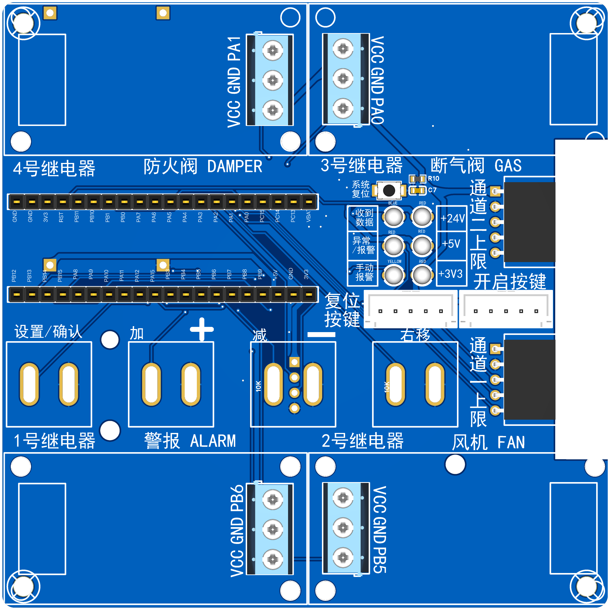
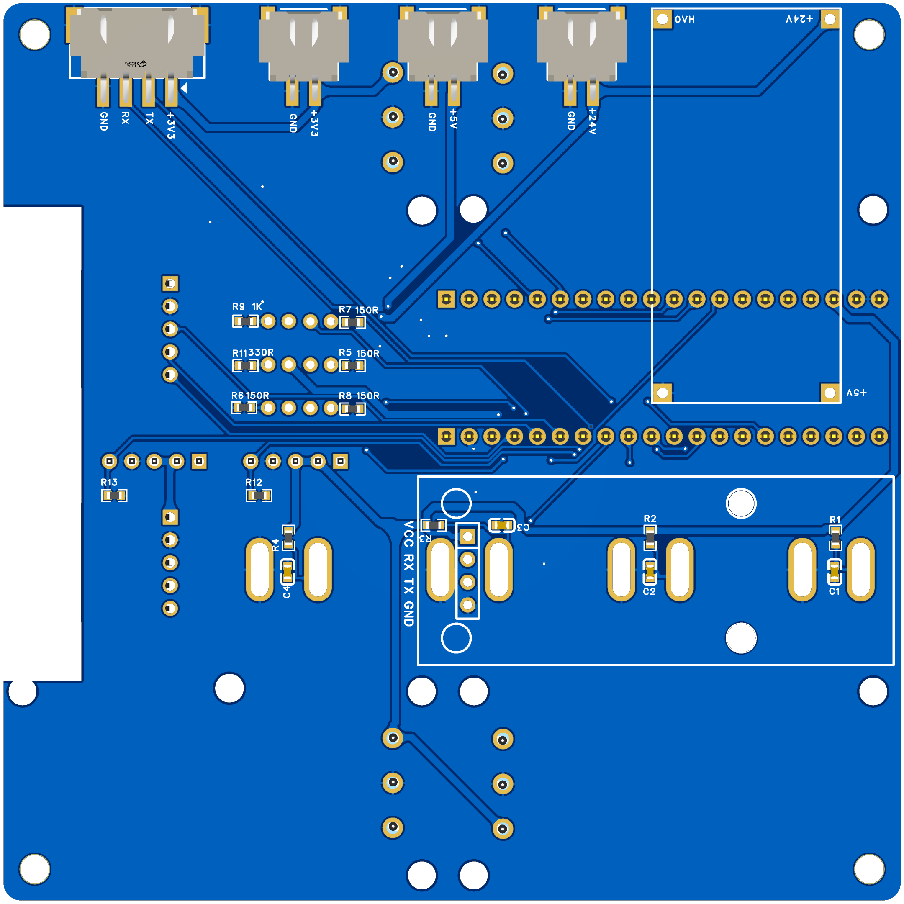
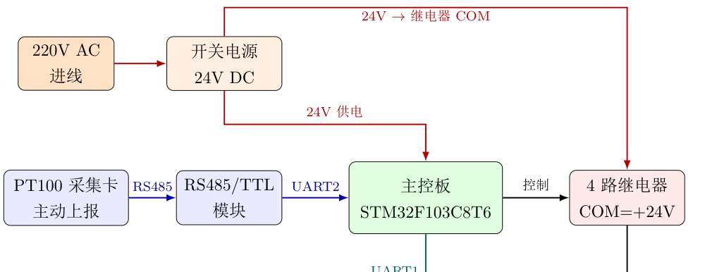
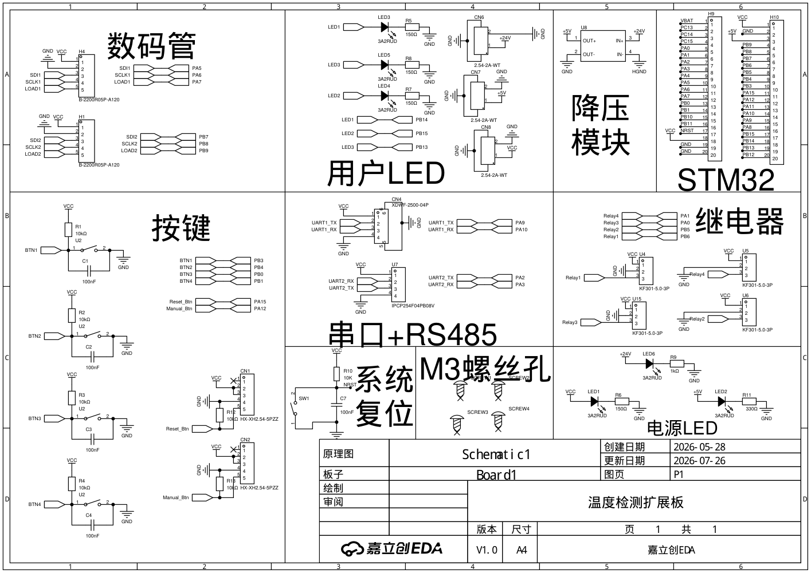

# 八通道 PT100 温控报警主机

厨房与管道防火用的温度监控主机，2026 年 7 月交付客户现场使用。实时采集 8 路 PT100 温度，任一通道超过阈值即报警，联动 4 路继电器：声光警报接通、风机停转、燃气断气阀关闭、防火阀关闭。报警锁定后由人工复位；断电时所有继电器释放，防火阀保持常开，故障时直接断电不影响其他设备。

Eight-channel PT100 over-temperature alarm controller for kitchen and duct fire protection, delivered to a customer in July 2026. STM32F103C8T6 reads a Modbus RS485 PT100 acquisition card, drives four relays (siren, fan, gas valve, fire damper), with seven-segment display, threshold keys and a fail-safe power-off behaviour. Hardware in EasyEDA Pro, firmware in C with STM32 HAL and CMake.




## 硬件

扩展主控板，嘉立创EDA 设计，STM32F103C8T6 核心板、降压模块和 RS485/TTL 模块插装在板上；板上有两组三位数码管（74HC595 驱动）、4 个设置键和手动、复位键、3 只面板指示灯、4 路继电器驱动输出、调试串口。24V 开关电源同时给主控板和继电器公共端供电。





工程文件、原理图 PDF 和制板文件在 `Hardware/`。

## 固件

`Software/`，STM32CubeMX 加 CMake，arm-none-eabi-gcc。

- 温度：PT100 采集卡配置为主动上报，MCU 通过 UART2 只收不发，解析 Modbus 0x04 帧。
- 报警逻辑：CH1 到 CH7 一组阈值，CH8 单独一组；传感器故障显示 Err；报警锁定，人工复位后 3 分钟抑制期，避免 PT100 热惯性造成余温反复触发。
- 防火阀：独立状态机，报警关阀、复位开阀，执行器内置限位自停。
- 人机：数码管轮显各路温度，箱内 4 键设置阈值并存 Flash；门板手动键可强制触发或解除报警用于联动测试。
- 可靠性：独立看门狗约 1.6 秒；调试串口 UART1 每秒打印状态。
- 分层：`App/logic/` 业务不碰寄存器，`App/driver/` 设备驱动，`Core/` 为 CubeMX 生成的 BSP，`board_config.h` 集中引脚语义和可调参数。

构建、烧录、配置项和各文件职责见 `Software/README.md`。

## 交付文档

`Doc/交付说明.pdf`：面向现场安装与维护人员的说明书，含配电箱信号流、端子对照表、防火阀接线、显示与操作说明、报警逻辑、故障排查和参数表。

## 目录

```
Hardware/   嘉立创EDA 工程、原理图 PDF、制板文件、图片
Software/   STM32F103 固件工程，含 README 和代码说明
Doc/        交付说明书（LaTeX 源与 PDF）
```

## 版本

- 2026-07：第一版交付，本地测温、显示、设置与四路联动。
- 第二版联网改造进行中，不在本仓库：主控板集成化，Linux 网关接入网线、Wi-Fi、4G，远程阈值与报警录像。
