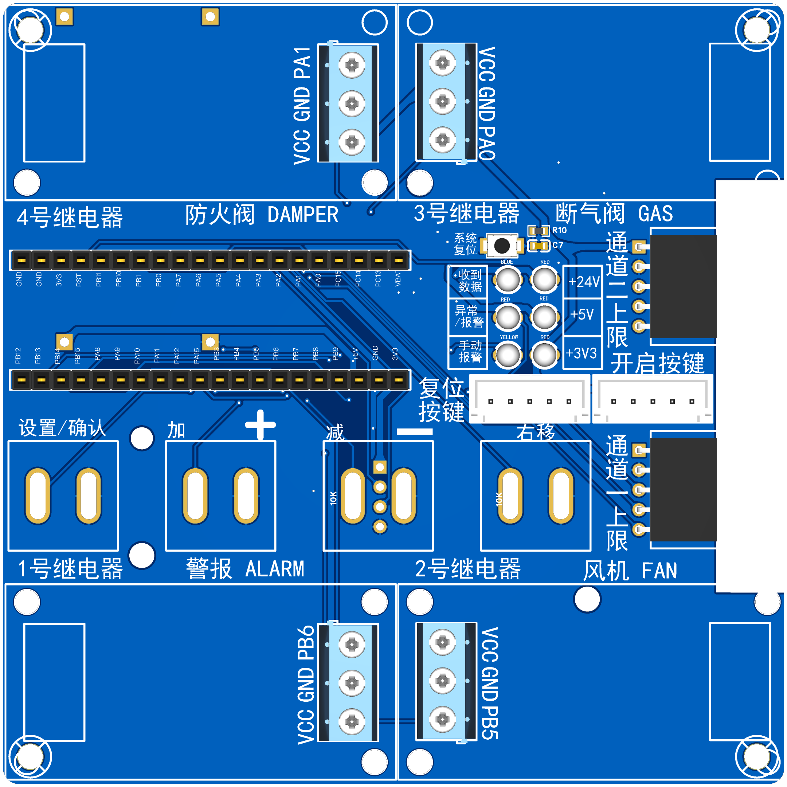
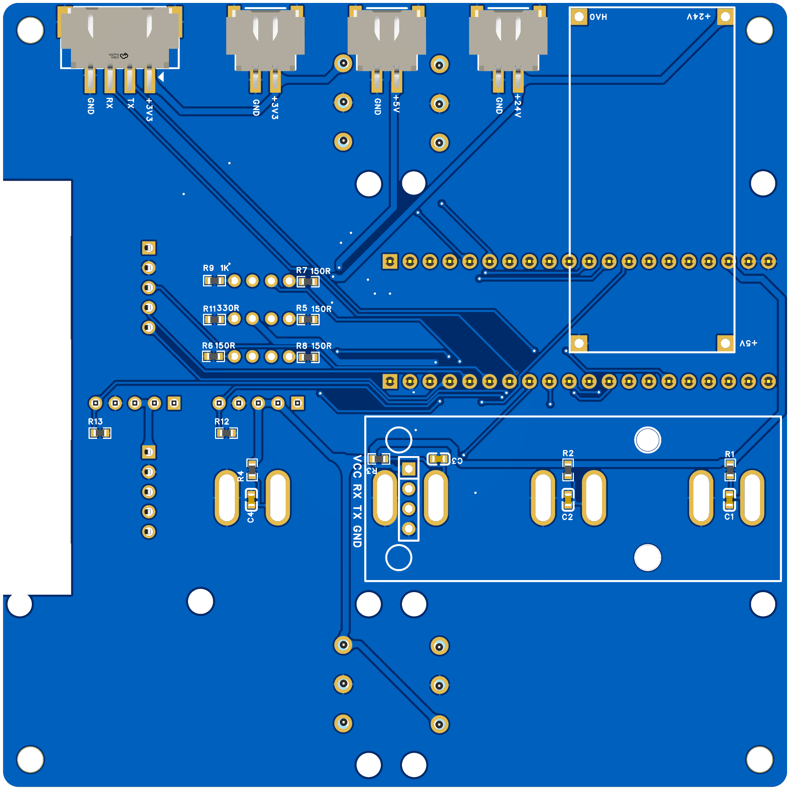
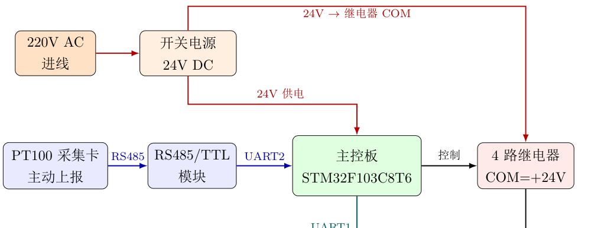
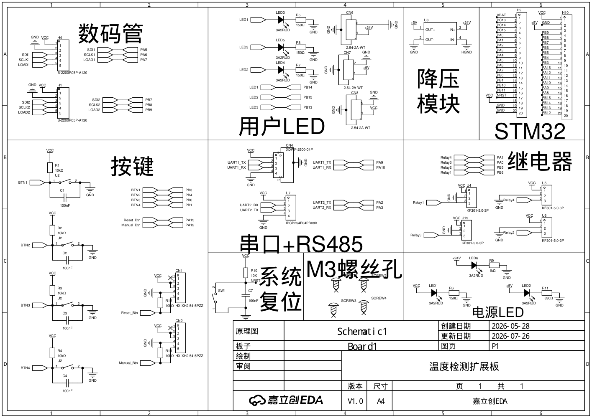
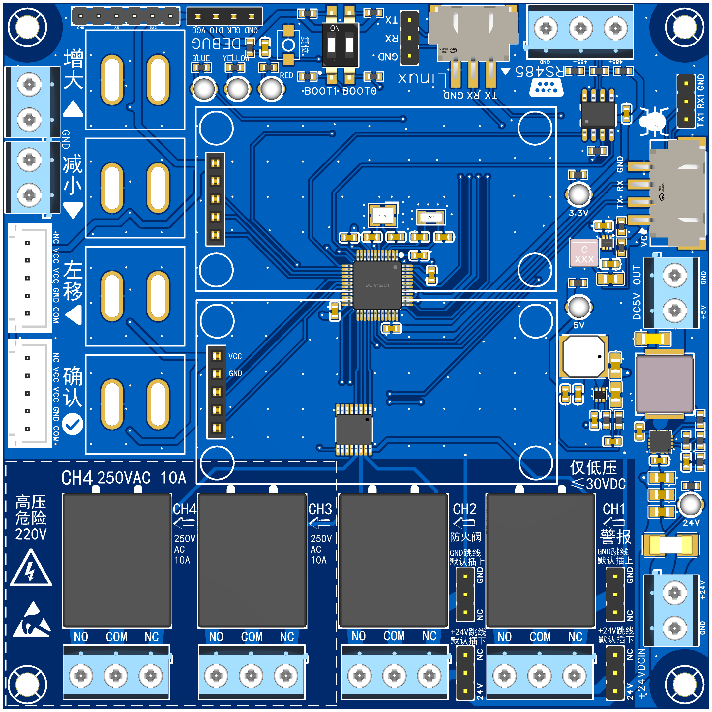
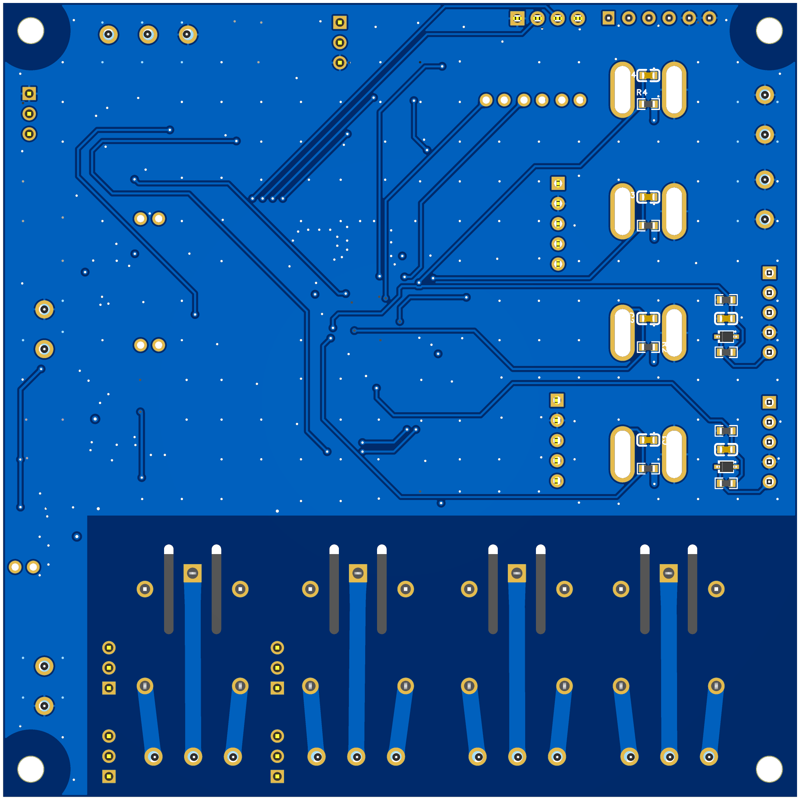
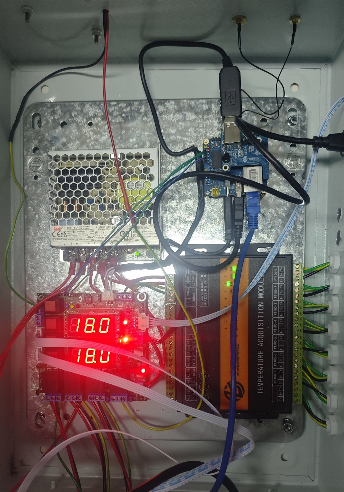
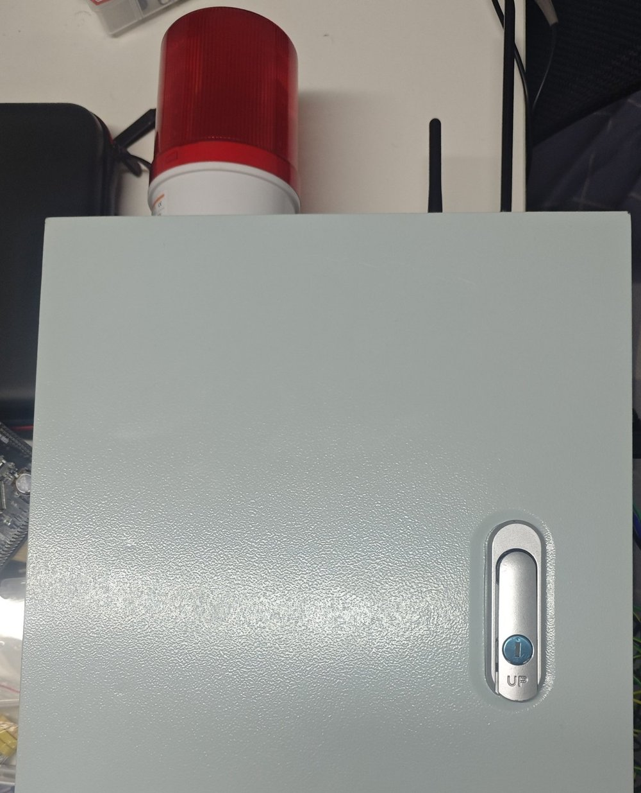

# 8-Channel PT100 Over-Temperature Alarm Controller

English | [中文](README_CN.md)

Temperature monitoring and alarm controller for kitchen and exhaust duct fire protection, built under a paid contract and delivered to the customer site in July 2026. It reads 8 PT100 channels in real time; when any channel passes its threshold it drives four relays: siren and beacon on, fan off, gas shut-off valve closed, fire damper closed. The alarm latches until a manual reset. On power loss every relay releases and the fire damper stays open, so a controller failure only removes itself and never blocks other equipment.

I am the sole hardware and firmware designer.




## Hardware, version 1

Carrier board designed in EasyEDA Pro. An STM32F103C8T6 core module, a buck module and an RS485 to TTL module plug into it. The board carries two 3-digit 7-segment displays driven by 74HC595, four setting keys plus manual and reset keys, three panel indicators, four relay driver outputs and a debug UART. A 24 V switching supply powers both the board and the relay common.





Project files, schematic PDF and fabrication files are in `Hardware/`.

## Firmware

`Software/`: STM32CubeMX plus CMake, arm-none-eabi-gcc.

- Temperature: the PT100 acquisition card is set to report on its own; the MCU only listens on UART2 and parses Modbus function 0x04 frames.
- Alarm logic: one threshold for CH1 to CH7 and a separate one for CH8; a failed sensor shows Err; the alarm latches, and after a manual reset a 3-minute hold-off stops residual heat at the PT100 probes from retriggering it.
- Fire damper: its own state machine, closes on alarm and opens on reset; the actuator stops at its built-in limit switches.
- User interface: the displays cycle through the channel temperatures; four keys inside the cabinet set thresholds, stored in flash; a manual key on the door forces or clears the alarm for interlock testing.
- Reliability: independent watchdog of about 1.6 s; the debug UART1 prints the status every second.
- Structure: `App/logic/` holds business logic and never touches registers, `App/driver/` holds device drivers, `Core/` is the CubeMX-generated BSP, and `board_config.h` collects pin meanings and tunable parameters.

Build, flashing, configuration options and file responsibilities are in `Software/README.md`.

## Delivery documentation

`Doc/交付说明.pdf`: manual for the site installers and maintenance staff, with the cabinet signal flow, terminal tables, fire damper wiring, display and operation, alarm logic, troubleshooting and the parameter table. Written in Chinese for the customer.

## Version 2: networked controller

Version 2 merges the core module, buck module, RS485 module and relay modules of version 1 into one controller board and adds an interface to a Linux gateway. In November 2026 the complete system was assembled into its enclosure, and temperature readings, relay interlocks, alarm latch and reset, HTTPS data upload and alarm video recording all passed bench testing.




- STM32F103 on board, with SWD, BOOT switch, reset and debug UART.
- 24 V input; 24 V to 5 V 5 A for the Linux gateway, 24 V to 5 V 2 A and 5 V to 3.3 V for the board, all fused and protected.
- Four relays rated 250 VAC 10 A; a slot in the PCB isolates the mains relay area from the low-voltage logic; CH1 and CH2 can use 24 V or GND as common through jumpers.
- RS485 transceiver to the PT100 acquisition card and a separate UART to the Linux gateway; the displays, four setting keys and indicators of version 1 are kept.

| Inside the enclosure, running | Closed enclosure |
|---|---|
|  |  |

Schematic: [Hardware/v2/原理图.pdf](Hardware/v2/原理图.pdf). The gateway software lives in a separate repository.

## Folders

```
Hardware/   version 1 EasyEDA project, schematic PDF, fabrication files, images; v2/ holds version 2 renders and schematic
Software/   STM32F103 firmware project with its README and code notes
Doc/        delivery manual, LaTeX source and PDF
```

## History

- 2026-07: version 1 delivered: local temperature measurement, display, settings and four-way interlock.
- 2026-10: version 2 controller board designed; Linux gateway with Ethernet, Wi-Fi and 4G, remote thresholds and alarm video.
- 2026-11: version 2 assembled into its enclosure; all functions passed bench testing.
